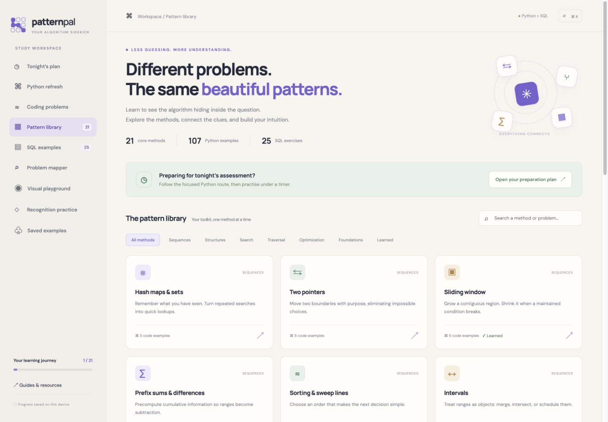
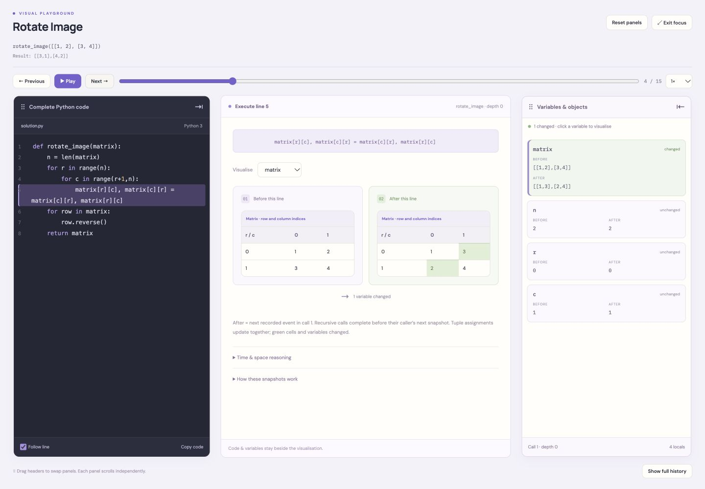
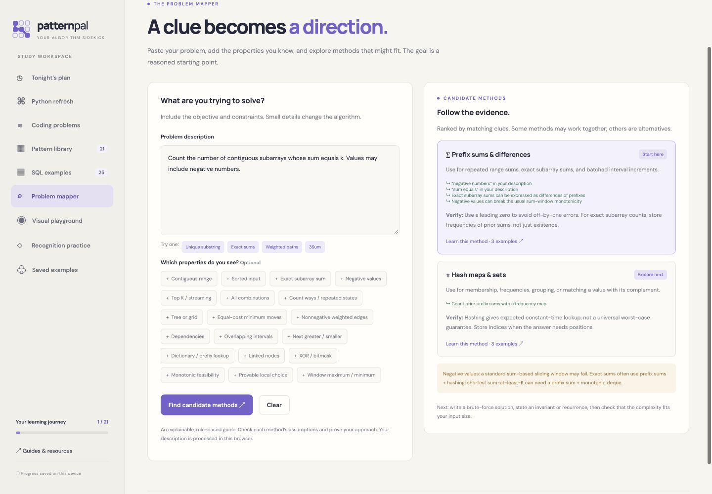
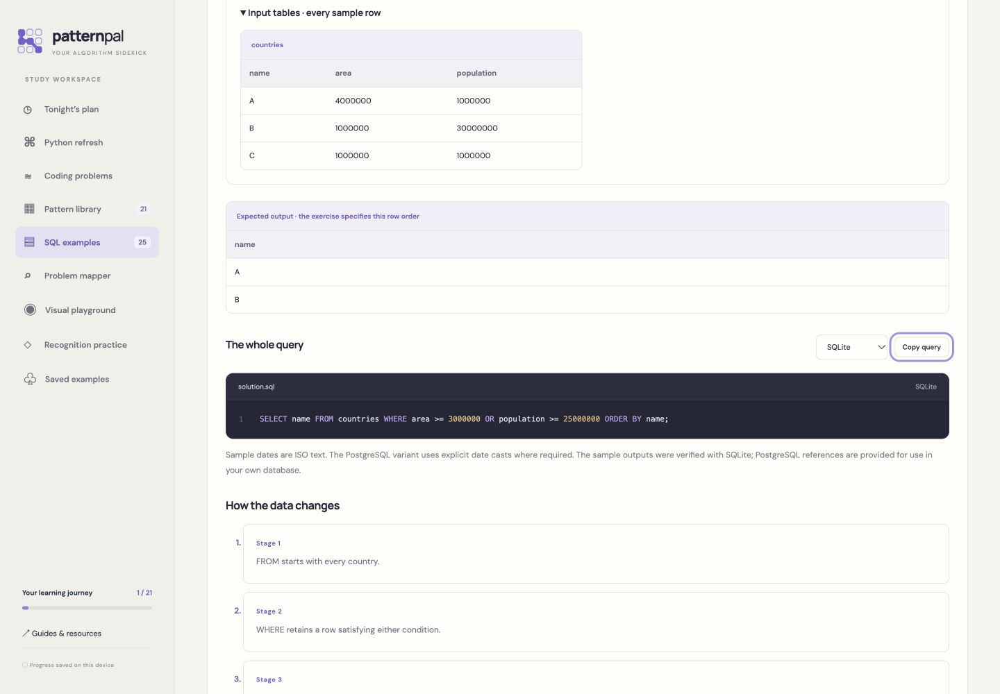

# PatternPal

**Your algorithm sidekick.** Learn to recognise the pattern behind a coding problem, understand how its solution changes the data, and practise the implementation in your own IDE.

PatternPal is an interactive React learning workspace for algorithms, Python and SQL. It combines complete reference solutions, detailed complexity explanations, a problem-to-pattern mapper and visual execution playgrounds.

**Live demo:** [pattern-pal-pathway.lovable.app](https://pattern-pal-pathway.lovable.app/)

**21 patterns · 107 coding examples · 16 Python refreshers · 232 traced input cases · 25 SQL examples**



[Get started](#get-started) · [Features](#features) · [Screenshots](#screenshots) · [Learning journey](#learning-journey) · [Development](#development)

## Features

- **Understand the method.** Each pattern explains its definition, recognition clues, invariant or recurrence, assumptions, failure cases and connections to other methods.
- **Read the complete solution.** Coding examples include constraints, sample inputs and outputs, complete Python code, block-by-block explanations and copy actions for your IDE.
- **Derive the complexity.** Explanations account for actual passes, loop bounds, amortised operations, recursion depth, retained structures, input mutation and output space. Expected and worst-case bounds are distinguished where they differ.
- **See the data change.** Every coding example and Python refresher has a playground with recorded source-line events, before/after values, indexed arrays, matrices, object snapshots and recursive call IDs.
- **Map an unfamiliar problem.** The local, rule-based mapper suggests candidate methods with matching evidence and cautions. Multiple methods can combine, or offer alternative approaches.
- **Refresh Python.** Sixteen worked examples and fourteen pitfall notes cover collections, iteration, slicing, sorting, stacks, queues, heaps and common boundary errors.
- **Understand SQL through examples.** Twenty-five lessons include complete queries, sample schemas and rows, expected results, explanation stages and SQLite/PostgreSQL references.
- **Build transferable skills.** A focused study route, mixed recognition questions, bookmarks and manual readiness checks support independent practice.

The website provides reference code and recorded visualisations. Run your own Python and SQL in your IDE or database client. No account, backend or API key is required.

<details>
<summary>Explore all 21 pattern families</summary>

- Hash maps and sets
- Two pointers
- Sliding window
- Prefix sums and differences
- Sorting and sweep lines
- Intervals
- Binary search
- Fast and slow pointers
- Linked-list rewiring
- Stacks and monotonic stacks
- Queues and monotonic deques
- Heaps and priority queues
- DFS and tree recursion
- Breadth-first search
- Backtracking
- Greedy algorithms
- Dynamic programming
- Graph algorithms
- Tries and string matching
- Bits and mathematics
- Matrices and simulation

Most families have five worked examples; dynamic programming has seven. Examples also explain when an alternative method improves on the family's usual approach.

</details>

## Get started

Use **Node.js 20.19+ on the Node 20 line, or Node.js 22.12+**, with npm. Python 3 is only needed to regenerate or verify the teaching content.

With access to this repository:

```bash
git clone https://github.com/ArifMehmood16/pattern-pal.git
cd pattern-pal
npm install
npm run dev
```

Open [http://localhost:8080/#assessment](http://localhost:8080/#assessment). The configured development port is **8080**; use the URL printed by Vite if that port is occupied.

To use the earlier local address explicitly:

```bash
npm run dev -- --host 127.0.0.1 --port 5178
```

Then open [http://127.0.0.1:5178/#assessment](http://127.0.0.1:5178/#assessment). Local progress belongs to the browser origin, so switching between hosts or ports gives you a separate progress store.

## Screenshots

These screenshots were captured from the running application. Images are stored in [docs/screenshots](docs/screenshots), so they travel with the repository.

### Visual execution playground

Keep the whole solution, variable inspector and data visualisation together. **Focus playground** fills the viewport; drag panel headers to swap their docks, scroll panels independently, and use Play/Pause, speed controls or individual steps. Disable **Follow line** to browse the code freely. Click a variable to inspect it, or choose another supplied input case.

This Rotate Image example shows the two matrix cells changing together during a tuple assignment, alongside the exact highlighted source line.



### Explainable problem mapper

Describe the objective and constraints, then inspect the evidence behind each suggestion. For example, exact subarray sums with negative values lead to prefix sums and a frequency map; the mapper explains why a standard sum window may fail. Descriptions are processed in your browser without an external AI call.



### SQL examples and queries

Follow the input rows through the expected output, read the complete query, and study each logical stage. Switch between SQLite and PostgreSQL references and copy the schema or query into your own tools.



## Learning journey

1. **Understand:** restate the contract, recognise the relevant clues, and explain the invariant or recurrence.
2. **Predict:** work out the next data state before advancing the playground.
3. **Rebuild:** implement the solution from a blank file in your IDE.
4. **Vary:** change one constraint, such as duplicates, negative values, sortedness or edge weights.
5. **Mix:** attempt unfamiliar problems without looking at method tags.
6. **Justify:** explain correctness and derive time and space costs from your implementation.
7. **Revisit:** return to weak patterns and solve a new variation after a delay.

The built-in preparation route contains **400 minutes of focused work**, with an optional **45-minute SQL block**. Add breaks and sleep. The broader library supports continued learning; it is not a requirement to finish every example in one sitting.

Practising this process develops the reasoning needed for unseen questions. Reading familiar solutions alone does not establish mastery, and this collection does not cover every algorithm. Advanced range structures, specialised dynamic programming and deeper graph algorithms are natural next steps.

## How the visual traces work

The playgrounds replay **232 recorded CPython executions** across all 123 coding/refresher examples. They do not execute learner code in the browser.

- Each snapshot is captured **before** its displayed source line.
- The next recorded event **in the same function call** supplies the after state. Recursive calls have separate IDs.
- Tuple assignments show their simultaneous changes together. Green values and cells indicate changes.
- All recorded local values remain accessible; large arrays, objects and matrices scroll within their panels.
- Built-in operations show their before/after values rather than their internal C implementation.
- Conceptual DP matrices are labelled separately from the efficient storage used by the executing solution.

The source examples explain their tradeoffs. For example, randomised quickselect mutates its input and has expected linear time with a quadratic worst case. Output storage is distinguished from auxiliary space, and large-integer arithmetic assumptions are stated where relevant.

SQL sample outputs are checked with SQLite. PostgreSQL queries are reference variants and are not executed by the app's verification suite. Query performance depends on cardinalities, indexes, statistics and the chosen plan; use `EXPLAIN` in your target database.

## Development

The app uses **React 19, Vite 8, JavaScript and plain CSS**, with hash-based navigation and static JSON content. Python scripts generate and verify the teaching material; Python is not a website runtime dependency.

```bash
npm run dev               # development server; prepares public content first
npm run build             # production files in dist/
npm run preview           # serve the production build; open Vite's printed URL
npm test                  # content integrity, mapper and study-plan checks
npm run test:examples     # Python solutions, SQLite outputs and optimisation checks
npm run content:generate  # regenerate teaching content and recorded traces
```

`npm run build:dev` is also available for a development-mode build.

### Project structure

```text
src/
  components/             # lessons, mapper, SQL examples and playground UI
  data/                   # canonical patterns, Python, SQL and study content
  lib/                    # matching engine, hash routes and local progress
  styles.css              # shared visual system and responsive layouts
public/
  traces/                 # recorded CPython input-case executions
  practice_fixtures.py     # node definitions and sample builders for your IDE
docs/screenshots/         # application screenshots used by this README
scripts/prepare-content.mjs
*_content.py              # teaching-content generators
verify_*.py               # content and solution verification
```

The main teaching assets are [patterns.json](src/data/patterns.json), [python-drills.json](src/data/python-drills.json), [sql-lessons.json](src/data/sql-lessons.json) and [study-plan.json](src/data/study-plan.json).

`predev` and `prebuild` copy the canonical pattern data and Python fixtures into `public/`. After regenerating content while the development server is running, prepare the assets and reload:

```bash
npm run content:generate
node scripts/prepare-content.mjs
```

Change teaching content in its generators, then regenerate it. Preserve the relationship between displayed source code and recorded traces.

### Routes and local progress

The default route is `#assessment`. Other screens are `#python`, `#problems`, `#library`, `#sql`, `#finder`, `#lab`, `#practice`, `#saved` and `#resources`. Specific lessons support routes such as `#pattern/pointers/3`, `#python/0` and `#sql/0`.

Manual learning progress and bookmarks use `pattern-atlas-v1`; study/readiness checkboxes use `pattern-atlas-journey-v1`. These existing keys are retained for compatibility. Progress stays in the current browser and origin, without account or device synchronisation. The mapper keeps descriptions in memory. Google Fonts are optional; system fonts provide fallbacks.

### Continue in Lovable

Import the repository as the existing React/Vite application. Follow [AGENTS.md](AGENTS.md) for editing instructions and [LOVABLE_PROMPT.md](LOVABLE_PROMPT.md) for the teaching specification. Preserve the supplied content, traces, routes and existing favicon. The implementation can be edited in place without replacing its stack or adding a backend.
